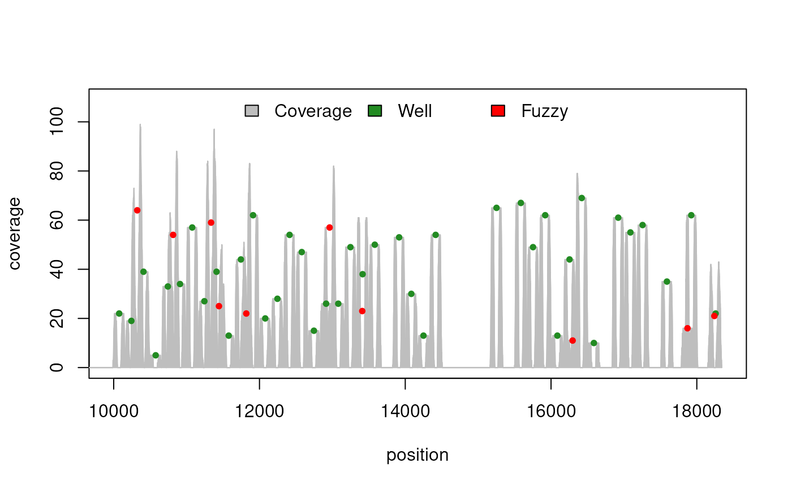
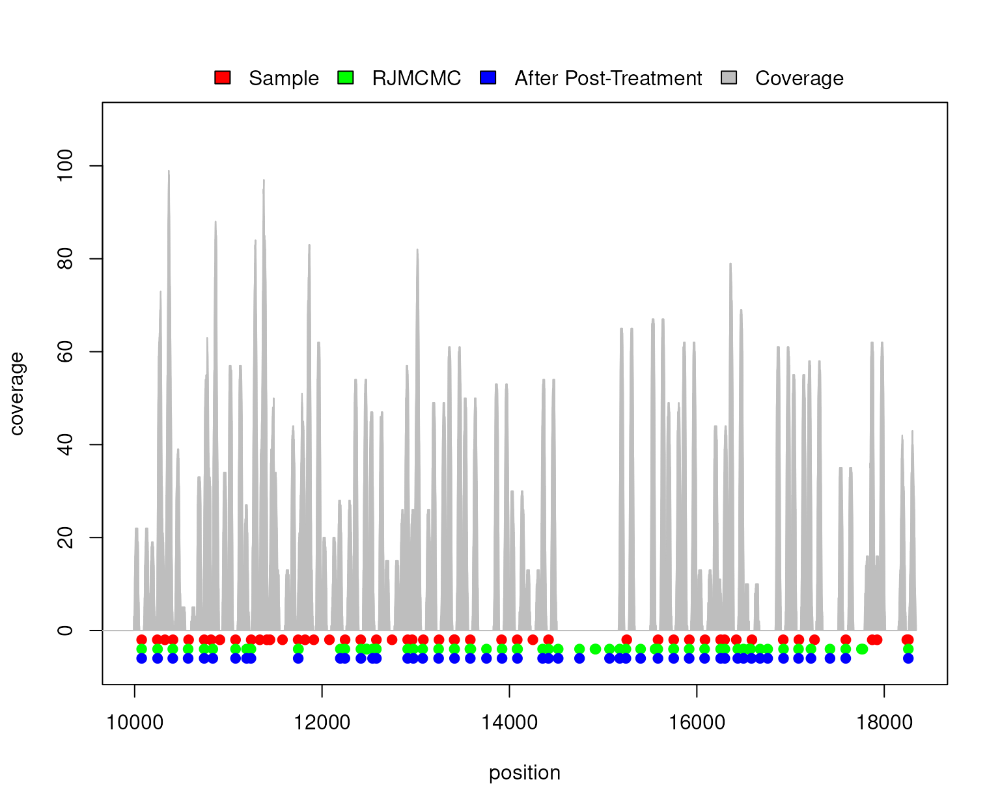

# Nucleosome Positioning

\
**Package**: *RJMCMCNucleosomes*\
**Authors**: Pascal Belleau \[aut\] (ORCID:
<https://orcid.org/0000-0002-0802-1071>), Rawane Samb \[aut\], Astrid
Deschênes \[cre, aut\] (ORCID: <https://orcid.org/0000-0001-7846-6749>),
Khader Khadraoui \[aut\], Lajmi Lakhal-Chaieb \[aut\], Arnaud Droit
\[aut\]\
**Version**: 1.37.1\
**Compiled date**: 2026-11-04\
**License**: Artistic-2.0\

\

## Licensing and citing

The **RJMCMCNucleosomes** package and the underlying
**RJMCMCNucleosomes** code are distributed under the Artistic license
2.0. You are free to use and redistribute this software.

If you use this package for a publication, we would ask you to cite the
following:

> Samb R, Khadraoui K, Belleau P, et al. (2015) Using informative
> Multinomial-Dirichlet prior in a t-mixture with reversible jump
> estimation of nucleosome positions for genome-wide profiling.
> Statistical Applications in Genetics and Molecular Biology. Volume 14,
> Issue 6, Pages 517-532, ISSN (Online) 1544-6115, ISSN (Print)
> 2194-6302, December 2015,
> [doi:10.1515/sagmb-2014-0098](https://doi.org/10.1515/sagmb-2014-0098)

The Research Resource Identifier (RRID) for the **RJMCMCNucleosomes**
package is **RRID:SCR_029241**.

## Introduction

Global gene expression patterns are established and maintained by the
concerted actions of transcription factors (TFs) and the proteins that
constitute chromatin. The key structural element of chromatin is the
nucleosome, which consists of an octameric histone core wrapped by
145-147 bp of DNA and connected to its neighbor by approximately 10-80
bp of linker DNA (Polishko et al. 2012).

The literature on nucleosome positioning commonly focuses on frequentist
inferences within parametric approaches (see for instance Chen et al.
(2010) and Xi et al. (2010)). In those works, the detection of
nucleosome positions is done using a hidden Markov model with an assumed
known order.

The **RJMCMCNucleosomes** package is an implementation of a fully
Bayesian hierarchical model for profiling of nucleosome positions based
on high-throughput short-read data (MNase-Seq data). The implementation
is based on a strategy which incorporates four aspects. First, it
jointly models local concentrations of directional reads. Second, it
uses a Multinomial-Dirichlet model in the construction of an informative
prior distribution coupled to a t-mixture model with unknown degrees of
freedom. Third, the number of nucleosomes is considered to be a random
variable and refers to a prior distribution. Fourth, the unknown
parameters are simultaneously estimated using the reversible jump Markov
chain Monte Carlo (RJMCMC) simulation technique (see for instance Green
(1995) and Richardson and Green (1997)).

Detailed information about the model can be found in the article
mentioned in the citing section.

\

## Installation

To install the latest version of the **RJMCMCNucleosomes** package,
*[BiocManager](https://CRAN.R-project.org/package=BiocManager)* must
first be installed:

``` r

if (!requireNamespace("BiocManager", quietly=TRUE))
    install.packages("BiocManager")

BiocManager::install("RJMCMCNucleosomes")
```

The **RJMCMCNucleosomes** package contains C++ code that uses the GNU
Scientific Library (GSL). When the package is installed from source, the
GSL must be available on the system (for example, the `libgsl-dev`
package on Debian/Ubuntu or `brew install gsl` on macOS). On Windows,
the GSL is included in Rtools.

\

## Loading the RJMCMCNucleosomes package

As with any R package, the **RJMCMCNucleosomes** package should first be
loaded with the following command:

``` r

library(RJMCMCNucleosomes)
```

\

## RJMCMCNucleosomes analysis

A typical **RJMCMCNucleosomes** analysis consists of the following
steps:

1.  Segment the analyzed region into candidate regions that have
    sufficient aligned reads. The initial region cannot be wider than
    one chromosome.
2.  Estimate nucleosome positions for each region.
3.  Regroup all regions together. The final region cannot be wider than
    one chromosome.
4.  Post-process predictions of the regrouped region to revise certain
    predictions.

## RJMCMCNucleosomes analysis step by step

A synthetic nucleosome sample containing 50 nucleosomes (40
well-positioned + 10 fuzzy) has been created using the Bioconductor
package *[nucleoSim](https://bioconductor.org/packages/3.24/nucleoSim)*.
This synthetic sample will be used throughout this analysis.

``` r

## Load nucleoSim package
library(nucleoSim)

val.num       <- 50     ### Number of well-positioned nucleosomes
val.del       <- 10     ### Number of well-positioned nucleosomes to delete
val.var       <- 30     ### Variance associated to well-positioned nucleosomes
val.fuz       <- 10     ### Number of fuzzy nucleosomes
val.fuz.var   <- 50     ### Variance associated to fuzzy nucleosomes
val.max.cover <- 70     ### Maximum coverage for one nucleosome
val.nuc.len   <- 147    ### Nucleosome length
val.len.var   <- 10     ### Variance associated to the length of the reads
val.lin.len   <- 20     ### The length of the DNA linker
val.rnd.seed  <- 100    ### Set seed when result needs to be reproducible
val.offset    <- 10000  ### The number of bases used to offset all 
                        ### nucleosomes and reads

## Create sample using a Normal distribution
sample <- nucleoSim::syntheticNucReadsFromDist(wp.num=val.num,
                                    wp.del=val.del, wp.var=val.var,
                                    fuz.num=val.fuz, fuz.var=val.fuz.var,
                                    max.cover=val.max.cover, 
                                    nuc.len=val.nuc.len,
                                    len.var=val.len.var, 
                                    lin.len=val.lin.len,
                                    rnd.seed=val.rnd.seed,
                                    distr="Normal", offset=val.offset)

## Create visual representation of the synthetic nucleosome sample
plot(sample)
```



### Split the analyzed region into segments

It is suggested, in order to accelerate the learning process, to split
the analyzed region into segments. Moreover, it is mandatory to analyze
each chromosome separately since the `rjmcmc` function can only analyze
one chromosome at a time.

Region segmentation can be done using the `segmentation` function.
Beware that the larger the segment (parameter `maxLength`), the higher
the number of iterations needs to be to reach convergence during the
nucleosome prediction step.

``` r

## Load needed packages
library(GenomicRanges)

## Transform sample dataset into GRanges object
sampleGRanges <- GRanges(seqnames=sample$dataIP$chr, 
                            ranges=IRanges(start=sample$dataIP$start, 
                                        end=sample$dataIP$end), 
                            strand=sample$dataIP$strand)

## Segment sample into candidate regions
sampleSegmented <- segmentation(reads=sampleGRanges, zeta=147, 
                                        delta=40, maxLength=1000)

## Number of segments created
length(sampleSegmented)
## [1] 11
```

### Run RJMCMCNucleosomes for nucleosome predictions

The `rjmcmc` function must be run on each candidate region. As an
example, the first candidate region is processed using a very low number
of iterations. On real data, the number of iterations should be higher
(easily 1000000 iterations).

``` r

## Extract the first segment 
segment01 <- sampleSegmented[[1]]

## Run RJMCMC analysis
## A higher number of iterations is recommended for real analysis
resultSegment01 <- rjmcmc(reads=segment01, nbrIterations=100000, 
                            lambda=3, kMax=30,
                            minInterval=100, maxInterval=200, 
                            minReads=5, vSeed=1921)

## Print the predicted nucleosomes for the first segment
resultSegment01
## RJMCMCNucleosomes - Predicted nucleosomes
## 
## Call:
## rjmcmc(reads = segment01, nbrIterations = 1e+05, kMax = 30, lambda = 3, 
##     minInterval = 100, maxInterval = 200, minReads = 5, vSeed = 1921)
## 
## Number of nucleosomes:
## [1] 5
## 
## Nucleosomes positions:
## GRanges object with 5 ranges and 0 metadata columns:
##            seqnames    ranges strand
##               <Rle> <IRanges>  <Rle>
##   [1] chr_SYNTHETIC     10078      *
##   [2] chr_SYNTHETIC     10260      *
##   [3] chr_SYNTHETIC     10322      *
##   [4] chr_SYNTHETIC     10406      *
##   [5] chr_SYNTHETIC     10796      *
##   -------
##   seqinfo: 1 sequence from an unspecified genome; no seqlengths
```

### Regroup all regions

Once all segments have been analyzed, the predicted nucleosomes can be
merged together. Two functions are available to facilitate the merging
process:

- *mergeRDSFiles* function: A vector containing the names of all RDS
  files to merge is passed to it
- *mergeAllRDSFilesFromDirectory* function: the name of the directory
  (relative or absolute path) containing all RDS files to merge is
  passed to it

Beware that segments from different chromosomes should not be merged
together.

The segments of the sample, which has been created earlier, have all
been processed (using 500000 iterations) and saved in RDS files. Those
will now be merged together.

``` r

## The directory containing the results of all segments
## One RDS file has been created for each segment
directory <- system.file("extdata", "demo_vignette", 
                            package="RJMCMCNucleosomes")

## Merging predicted nucleosomes from all segments
resultsAllMerged <- mergeAllRDSFilesFromDirectory(directory)

resultsAllMerged
## 
## RJMCMCNucleosomes - Predicted nucleosomes
## 
## Number of nucleosomes:
## [1] 63
## 
## Nucleosomes positions:
## GRanges object with 63 ranges and 0 metadata columns:
##             seqnames    ranges strand
##                <Rle> <IRanges>  <Rle>
##    [1] chr_SYNTHETIC     10075      *
##    [2] chr_SYNTHETIC     10245      *
##    [3] chr_SYNTHETIC     10407      *
##    [4] chr_SYNTHETIC     10571      *
##    [5] chr_SYNTHETIC     10742      *
##    ...           ...       ...    ...
##   [59] chr_SYNTHETIC     17421      *
##   [60] chr_SYNTHETIC     17589      *
##   [61] chr_SYNTHETIC     17756      *
##   [62] chr_SYNTHETIC     17771      *
##   [63] chr_SYNTHETIC     18257      *
##   -------
##   seqinfo: 1 sequence from an unspecified genome; no seqlengths
```

### Post-process predictions

In some cases the RJMCMC method tends to over-split the distribution of
reads for a single nucleosome. Although this characteristic increases
the number of false positives, it is still beneficial for the regions
rich in nucleosomes.

A function, that merges closely positioned nucleosomes, has been
implemented to rectify the over-splitting and provide more conservative
results.

The `postTreatment` function must be run on the entire analyzed region
to be efficient. **It should not be run on segmented results**. The
function needs the positions of the reads used for the RJMCMC analysis.

The value of `extendingSize` should be kept low (below 20). A larger
value could cause the possible merge of true nucleosomes.

``` r

## Create a GRanges with the reads of the initial sample
reads <- GRanges(sample$dataIP)

## Number of nucleosomes before the post-treatment
resultsAllMerged$k
## [1] 63

## Use the post-treatment function
resultsPostTreatment <- postTreatment(reads=reads,
                            resultRJMCMC=resultsAllMerged,
                            extendingSize=15,
                            chrLength=max(start(reads), end(reads)) + 1000)


## Number of nucleosomes after the post-treatment
length(resultsPostTreatment)
## [1] 49
```

\

The `postTreatment` function can significantly reduce the number of
nucleosomes by merging closely positioned nucleosomes.

### Visualization of the predicted nucleosomes

Visualization of the predicted nucleosomes, with its associated read
coverage, is available in the **RJMCMCNucleosomes** package.

The `plotNucleosomes` function needs the nucleosome positions and the
reads, in a `GRanges` format, to create a graph. When reads are used to
predict more than one set of nucleosome positions (for example, before
and after post-treatment or results from different software), the
predictions can be merged in a `GRangesList` so that all predictions can
be plotted simultaneously.

``` r

## Extract reads to create a GRanges
reads <- GRanges(sample$dataIP)

## Merge predictions from before post-treatment and after post-treatment in 
## a GRangesList so that both results will be shown in graph
resultsBeforeAndAfter <- GRangesList(
        Sample=GRanges(rep("chr_SYNTHETIC", 
            length(c(sample$wp$nucleopos,sample$fuz$nucleopos))), 
            ranges=IRanges(start=c(sample$wp$nucleopos,sample$fuz$nucleopos),
                        end=c(sample$wp$nucleopos,sample$fuz$nucleopos)), 
            strand=rep("*", length(c(sample$wp$nucleopos,
                                sample$fuz$nucleopos)))),
        BeforePostTreatment=resultsAllMerged$mu,
        AfterPostTreatment=resultsPostTreatment)

## Create graph using nucleosome positions and reads
## The plot will show: 
## 1. nucleosomes from the sample
## 2. nucleosomes detected by rjmcmc() function
## 3. nucleosomes obtained after post-treatment 
plotNucleosomes(nucleosomePositions=resultsBeforeAndAfter, reads=reads, 
                    names=c("Sample", "RJMCMC", "After Post-Treatment"))
```



\

## RJMCMCNucleosomes analysis of one chromosome in one step

The `rjmcmcCHR` function can analyze an entire chromosome by
automatically splitting the reads into segments, running `rjmcmc` on
each segment, merging and post-processing the results. The intermediate
results are saved in a directory set by the `dirOut` parameter.

On real chromosome data, the `rjmcmcCHR` can take some time to execute.
We strongly suggest running it on a multi-core computer and to use as
many available cores as possible by setting the `nbCores` parameter.

``` r

## Load synthetic dataset of reads
data(syntheticNucleosomeReads)

## Number of reads in the dataset
nrow(syntheticNucleosomeReads$dataIP)

## Use the dataset to create a GRanges object
sampleGRanges <- GRanges(syntheticNucleosomeReads$dataIP)

## All reads are related to one chromosome called "chr_SYNTHETIC"
seqnames(sampleGRanges)

## Run RJMCMC on all reads
## The output directory is a temporary directory
result <- rjmcmcCHR(reads=sampleGRanges, 
                seqName="chr_SYNTHETIC", 
                dirOut=file.path(tempdir(), "testRJMCMCCHR"),
                zeta=147, delta=50, maxLength=1200,
                nbrIterations=500, lambda=3, kMax=30,
                minInterval=146, maxInterval=292, minReads=5,
                vSeed=10113, nbCores=2, saveAsRDS=FALSE, 
                saveSEG=FALSE)

result
```

\

When the `saveSEG` parameter is set to `TRUE` (default), the segments
created during the segmentation step are saved in a RDS file in the
`dirOut` directory. When the `saveAsRDS` parameter is set to `TRUE`, the
complete output of the `rjmcmc` function for each segment is saved in a
RDS file in the current working directory.

\

## Acknowledgements

Maintenance work for this version of the package (Bioconductor coding
compliance with `BiocCheck`, native routine registration for the C++
code, bug fixes, unit tests, continuous integration with GitHub Actions
and proofreading and improvement of the vignette and function
documentation) was carried out with assistance from Claude Code (Claude
Opus 5.5, Anthropic). All changes were reviewed, tested and approved by
the package maintainer, who remains responsible for the package content.

\

## Session info

Here is the output of
[`sessionInfo()`](https://rdrr.io/r/utils/sessionInfo.html) on the
system on which this document was compiled:

    ## R Under development (unstable) (2026-11-02 r90827)
    ## Platform: x86_64-pc-linux-gnu
    ## Running under: Ubuntu 24.04.4 LTS
    ## 
    ## Matrix products: default
    ## BLAS:   /usr/lib/x86_64-linux-gnu/openblas-pthread/libblas.so.3 
    ## LAPACK: /usr/lib/x86_64-linux-gnu/openblas-pthread/libopenblasp-r0.3.26.so;  LAPACK version 3.12.0
    ## 
    ## locale:
    ##  [1] LC_CTYPE=en_US.UTF-8       LC_NUMERIC=C              
    ##  [3] LC_TIME=en_US.UTF-8        LC_COLLATE=en_US.UTF-8    
    ##  [5] LC_MONETARY=en_US.UTF-8    LC_MESSAGES=en_US.UTF-8   
    ##  [7] LC_PAPER=en_US.UTF-8       LC_NAME=C                 
    ##  [9] LC_ADDRESS=C               LC_TELEPHONE=C            
    ## [11] LC_MEASUREMENT=en_US.UTF-8 LC_IDENTIFICATION=C       
    ## 
    ## time zone: UTC
    ## tzcode source: system (glibc)
    ## 
    ## attached base packages:
    ## [1] stats4    stats     graphics  grDevices utils     datasets  methods  
    ## [8] base     
    ## 
    ## other attached packages:
    ## [1] nucleoSim_1.41.0         RJMCMCNucleosomes_1.37.1 GenomicRanges_1.65.4    
    ## [4] Seqinfo_1.3.2            IRanges_2.47.5           S4Vectors_0.51.10       
    ## [7] BiocGenerics_0.59.12     generics_0.1.4           BiocStyle_2.41.0        
    ## 
    ## loaded via a namespace (and not attached):
    ##  [1] sass_0.4.10              bitops_1.1-0             stringi_1.8.9           
    ##  [4] lattice_0.23-1           magrittr_2.0.5           digest_0.6.39           
    ##  [7] grid_4.7.0               evaluate_1.0.5           bookdown_0.48           
    ## [10] fastmap_1.2.0            Matrix_1.7-6             jsonlite_2.0.0          
    ## [13] cigarillo_1.3.1          restfulr_0.0.17          consensusSeekeR_1.41.0  
    ## [16] BiocManager_1.30.27      httr_1.4.9               XML_3.99-0.25           
    ## [19] Biostrings_2.81.9        codetools_0.2-20         textshaping_1.0.5       
    ## [22] jquerylib_0.1.4          cli_3.6.6                crayon_1.5.3            
    ## [25] rlang_1.3.0              XVector_0.53.0           Biobase_2.73.2          
    ## [28] cachem_1.1.0             yaml_2.3.12              otel_0.2.0              
    ## [31] BiocBaseUtils_1.15.1     tools_4.7.0              parallel_4.7.0          
    ## [34] BiocParallel_1.47.0      Rsamtools_2.29.0         curl_8.1.0              
    ## [37] R6_2.6.1                 BiocIO_1.23.3            lifecycle_1.0.5         
    ## [40] stringr_1.6.0            rtracklayer_1.73.0       fs_2.1.0                
    ## [43] ragg_1.5.2               desc_1.4.3               pkgdown_2.2.0           
    ## [46] bslib_0.12.0             glue_1.8.1               Rcpp_1.1.2              
    ## [49] systemfonts_1.3.2        GenomicAlignments_1.49.2 xfun_0.62               
    ## [52] knitr_1.52               rjson_0.2.23             htmltools_0.5.9         
    ## [55] rmarkdown_2.32           compiler_4.7.0           RCurl_1.98-1.20

\

## References

Chen, K., L. Wang, M. Yang, et al. 2010. “Sequence Signature of
Nucleosome Positioning in Caenorhabditis Elegans.” *Genomics Proteomics
Bioinformatics* 8: 92–102.
<https://doi.org/10.1016/S1672-0229(10)60010-1>.

Green, P. 1995. “Reversible Jump Markov Chain Monte Carlo Computation
and Bayesian Model Determination.” *Biometrika* 82: 711–32.
<https://doi.org/10.1093/biomet/82.4.711>.

Polishko, Anton, Nadia Ponts, Karine G. Le Roch, and Stefano Lonardi.
2012. “NOrMAL: Accurate Nucleosome Positioning Using a Modified Gaussian
Mixture Model.” *Bioinformatics* 28 (12): 242–49.
<https://doi.org/10.1093/bioinformatics/bts206>.

Richardson, S., and P. Green. 1997. “On Bayesian Analysis of Mixtures
with an Unknown Number of Components.” *Journal of Royal Statistical
Society B* 59: 731–92.

Xi, L., Y. Fondufe-Mittendorf, L. Xia, J. Flatow, J. Widom, and J-P.
Wang. 2010. “Predicting Nucleosome Positioning Using a Duration Hidden
Markov Model.” *BMC Bioinformatics* 11: 346.
<https://doi.org/10.1186/1471-2105-11-346>.
